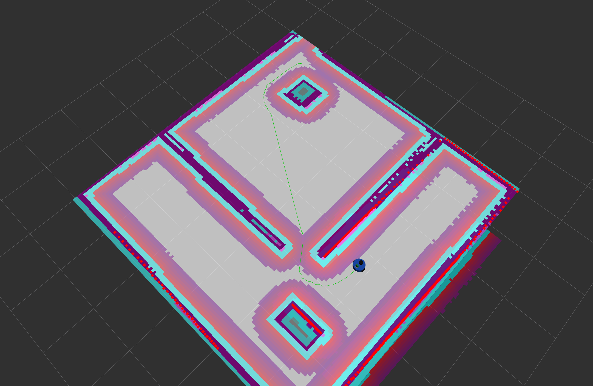
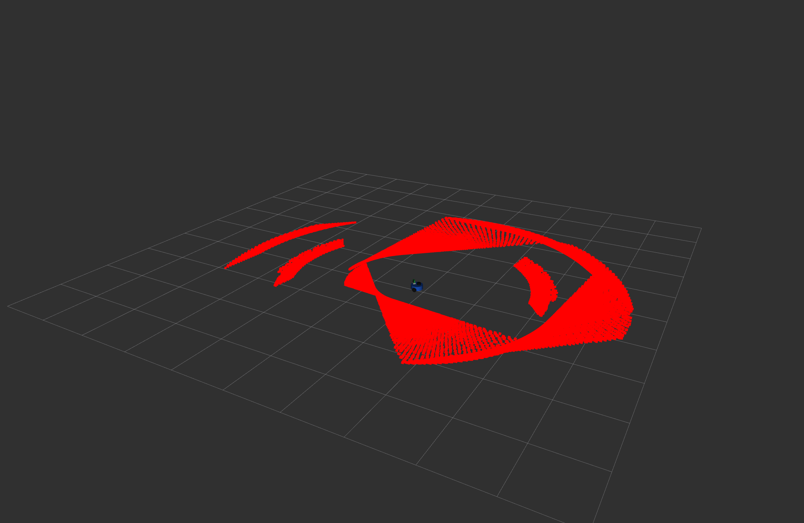
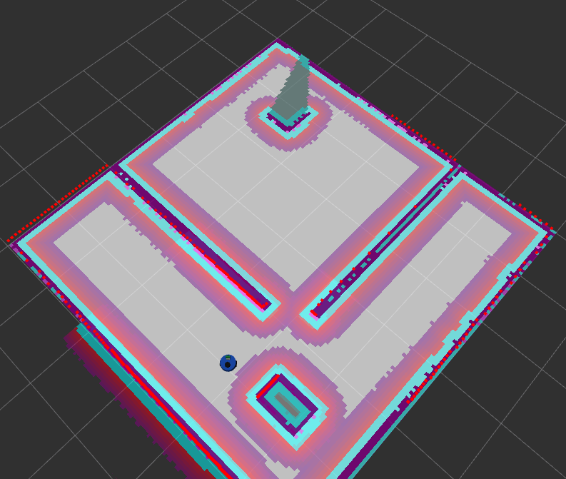
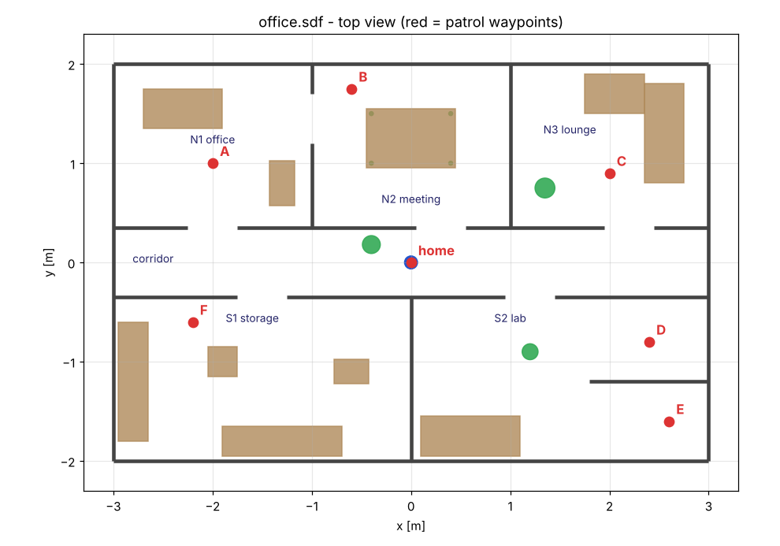
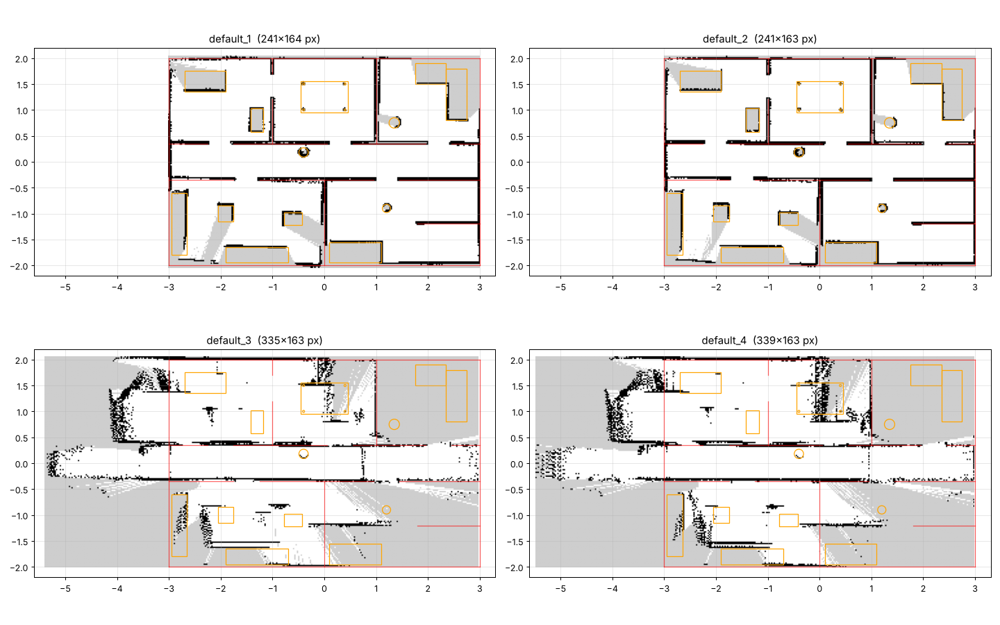
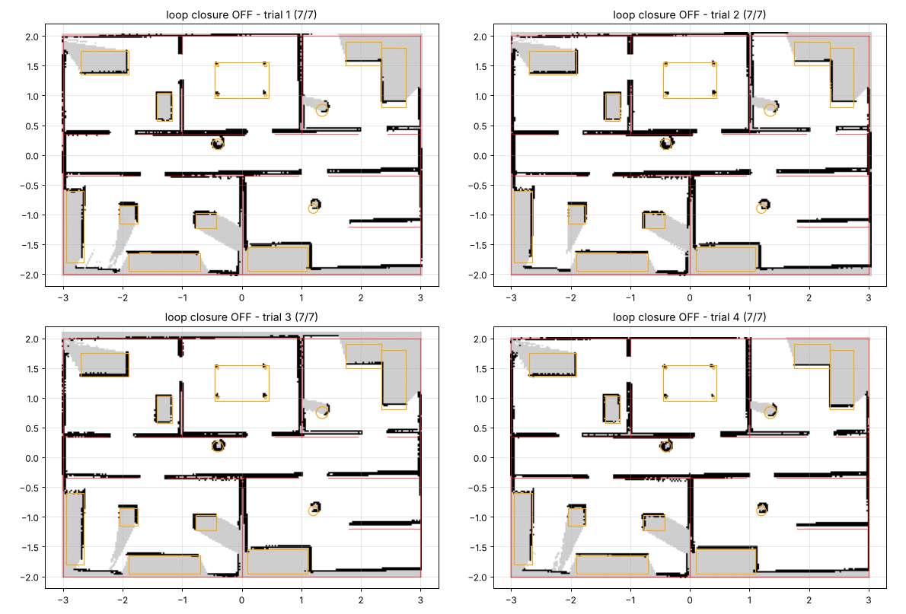

# alphabot2_sim – Digital twin of the AlphaBot2 robot (ROS 2 Jazzy + Gazebo Harmonic)

Simulation of the **Waveshare AlphaBot2-Pi** differential-drive robot with a pan-tilt camera, built as
part of my master's thesis *"Robot control using VR (Meta Quest 3) and ROS 2"* (Technical University of Košice).

The digital twin exposes the **same ROS 2 interface** that the real robot will use
(`/cmd_vel`, `/pan_cmd`, `/tilt_cmd`, `/camera/image_raw`), so the same VR control stack can drive
either the simulation or the real robot.



## Status

| Feature | Status |
|---|---|
| URDF/xacro model, differential drive (gz DiffDrive), odometry, TF | ✅ working |
| Pan-tilt camera (2 joints, `JointPositionController`) + camera stream | ✅ working |
| Simulated 2D lidar (`gpu_lidar`, `/scan`) | ✅ working |
| SLAM – `slam_toolbox` (online async) | ✅ working |
| Autonomous navigation – Nav2 (NavFn + Regulated Pure Pursuit) | ✅ working |
| Office world (6 × 4 m, corridor + 5 rooms), generated by a Python script | ✅ working |
| Waypoint patrol (`nav2_simple_commander`) with CSV logging + automated trials | ✅ working |
| Custom Nav2 Behavior Tree, A/B tested against the default tree | ✅ done (see experiment) |
| Head-tracked camera from Meta Quest 3 (`head_to_pantilt.py`) | 🚧 in progress |
| Real robot node (Raspberry Pi), sim-to-real comparison | 📋 planned |

> **Note on the lidar:** the real AlphaBot2 has **no lidar**. The lidar exists only in simulation
> to develop and test SLAM/Nav2. It can be disabled with `lidar:=false`.

## Measured in simulation (WSL2, Ubuntu 24.04)

| Topic | Configured | Measured (`ros2 topic hz`) |
|---|---|---|
| `/odom` | 30 Hz | ~27.8 Hz |
| `/scan` | 10 Hz | ~9.4 Hz |
| `/camera/image_raw` (320×240) | 15 Hz | ~14.7 Hz |

The rates are slightly below nominal because the real-time factor was ~0.95–0.98.

## Engineering notes (problems found and fixed)

**1. Odometry error while turning → distorted SLAM map.**
The first map contained doubled, rotated copies of the walls. Test: RViz fixed frame `odom`,
LaserScan decay time 10 s, slow 360° turn in place → the walls smeared into a "fan",
i.e. the odometry reported a different heading than the robot actually turned (wheel slip).



Fix in the model:
- wheel **collision geometry changed from cylinder to sphere** (stable single-point ground contact in DART),
- passive ball casters raised by **0.5 mm**, so the driven wheels carry the robot's weight.

After the fix the SLAM map is sharp and matches the world:



**2. Camera images not arriving in ROS 2 under WSL2.**
At 640×480 (~900 kB per frame) only the first frames reached ROS 2. Reducing the resolution to
**320×240** gives a stable ~14.7 Hz stream. This also matches the low-latency stream planned
for the real Raspberry Pi camera → Quest.

**3. WSL2 tips.** If `ros2 topic list` hangs, the ROS 2 daemon is stuck:
`pkill -9 -f _ros2_daemon` and use `--no-daemon`. Run only **one** `sim.launch.py` at a time
(two simulations publishing `/clock` cause "Moved backwards in time" warnings).

## Experiment: Behavior Tree A/B test → finding the real root cause

**Setup.** Office world (corridor 0.70 m, doorways 0.50 m), 7 patrol waypoints in all rooms
(`scripts/waypoint_patrol.py`). Every trial starts from scratch – new Gazebo, new SLAM map
(`tools/run_trials.sh`). Times are simulation time reported by Nav2.



**1. Default vs. custom Behavior Tree.** The custom tree
(`behavior_trees/patrol_small_robot.xml`) replans at 2 Hz and uses recovery actions sized for
a 13 cm robot (back up 0.10 m instead of 0.30 m, spin 45° instead of 90°, wait 2 s instead of 5 s).

| Tree (3 fresh runs each) | Goals reached | Recoveries | Successful run time |
|---|---|---|---|
| Default Nav2 tree | 17 / 21 | 54 | ~142 s |
| Custom tree | 16 / 21 | 63 | ~142 s |

→ **No measurable difference.** Both trees failed in the same way in about one of three runs.

**2. Diagnosis.** Nav2 logs showed an empty global plan (`Resulting plan has 0 poses`) followed by
`Failed to create plan` to every goal in the east half of the building – even after all costmaps
were cleared. So the obstacle was in the **SLAM map itself**. Saving the map after every trial and
overlaying the real floor plan confirmed it: failed runs had a **corrupted map** (localization lost,
map shifted ~2.4 m along the corridor), successful runs had a correct one.



**3. Root cause and fix.** The office has many repeating features (identical doorways, similar
rooms), which caused **false loop closures** in `slam_toolbox`. With `do_loop_closing: false`:

| SLAM setting | Runs with a corrupted map | Goals reached | Recoveries |
|---|---|---|---|
| Loop closure ON | 2 / 4 | – | – |
| **Loop closure OFF** | **0 / 4** | **28 / 28** | **0** |



**Takeaways.** Tuning the Behavior Tree could not fix a perception problem – A/B testing showed
that quickly and pointed to the real cause. Without loop closure the map has a small accumulated
drift (a few cm at the far end of the building); for longer missions the better fix is to keep
loop closure with stricter matching thresholds (next step).

## Installation

```bash
sudo apt update
sudo apt install -y ros-jazzy-ros-gz ros-jazzy-navigation2 ros-jazzy-nav2-bringup \
  ros-jazzy-slam-toolbox ros-jazzy-xacro ros-jazzy-robot-state-publisher \
  ros-jazzy-teleop-twist-keyboard ros-jazzy-rviz2 ros-jazzy-rqt-image-view

mkdir -p ~/ros2_ws/src && cd ~/ros2_ws/src
git clone https://github.com/oliywer/alphabot2_sim.git
cd ~/ros2_ws
source /opt/ros/jazzy/setup.bash
colcon build --symlink-install
source install/setup.bash
```

## Usage

```bash
# Terminal 1 – Gazebo + robot + ROS-Gazebo bridge
ros2 launch alphabot2_sim sim.launch.py

# Terminal 2 – SLAM + Nav2 + RViz
ros2 launch alphabot2_sim nav.launch.py

# Terminal 3 – manual driving (build the map first)
ros2 run teleop_twist_keyboard teleop_twist_keyboard
```

The default world is `office.sdf`; the original maze is still available:
`ros2 launch alphabot2_sim sim.launch.py world:=$(ros2 pkg prefix alphabot2_sim)/share/alphabot2_sim/worlds/maze.sdf`

Waypoint patrol and automated trials:
```bash
ros2 run alphabot2_sim waypoint_patrol.py --ros-args -p laps:=3
ros2 run alphabot2_sim waypoint_patrol.py --ros-args \
  -p behavior_tree:=$(ros2 pkg prefix alphabot2_sim)/share/alphabot2_sim/behavior_trees/patrol_small_robot.xml
tools/run_trials.sh default 4     # 4 fresh-start runs -> ~/ros2_ws/results/{default_N.csv,maps/,logs/}
```

1. Drive slowly around the maze until the map is complete.
2. Save the map: `ros2 run nav2_map_server map_saver_cli -f ~/ros2_ws/maps/maze`
3. In RViz click **2D Goal Pose** and choose a goal – Nav2 plans a path and drives the robot there.

Pan-tilt camera and camera view:
```bash
ros2 topic pub --once /pan_cmd  std_msgs/msg/Float64 "{data: 0.8}"
ros2 topic pub --once /tilt_cmd std_msgs/msg/Float64 "{data: -0.4}"
ros2 run rqt_image_view rqt_image_view /camera/image_raw
```

## Interface

| Topic | Type | Direction |
|---|---|---|
| `/cmd_vel` | `geometry_msgs/Twist` | ROS → robot |
| `/pan_cmd`, `/tilt_cmd` | `std_msgs/Float64` (rad) | ROS → robot |
| `/odom` | `nav_msgs/Odometry` | robot → ROS |
| `/scan` | `sensor_msgs/LaserScan` | robot → ROS (simulation only) |
| `/camera/image_raw`, `/camera/camera_info` | `sensor_msgs/Image`, `CameraInfo` | robot → ROS |
| `/tf`, `/joint_states`, `/clock` | | robot → ROS |

## Package structure

```
alphabot2_sim/
├── urdf/alphabot2.urdf.xacro   # robot model + Gazebo systems (DiffDrive, sensors, joint controllers)
├── worlds/office.sdf           # 6 × 4 m office: corridor + 5 rooms (default world)
├── worlds/maze.sdf             # 3 × 3 m test maze
├── config/gz_bridge.yaml       # ROS 2 <-> Gazebo topic bridge
├── config/nav2_params.yaml     # Nav2 (NavFn planner + Regulated Pure Pursuit controller)
├── config/slam_params.yaml     # slam_toolbox
├── launch/sim.launch.py        # Gazebo + robot + bridge
├── launch/nav.launch.py        # SLAM + Nav2 + RViz
├── rviz/alphabot2.rviz
├── behavior_trees/patrol_small_robot.xml  # custom Nav2 BT
├── scripts/waypoint_patrol.py  # Nav2 waypoint patrol + CSV logging
├── scripts/head_to_pantilt.py  # Meta Quest head pose -> pan/tilt (in progress)
├── tools/gen_office.py         # generates worlds/office.sdf
├── tools/run_trials.sh         # automated fresh-start trials (CSV, logs, maps)
├── results/                    # CSV results of the experiment
└── docs/                       # screenshots
```

Robot dimensions are approximate and will be calibrated against the real robot.

## License

MIT
